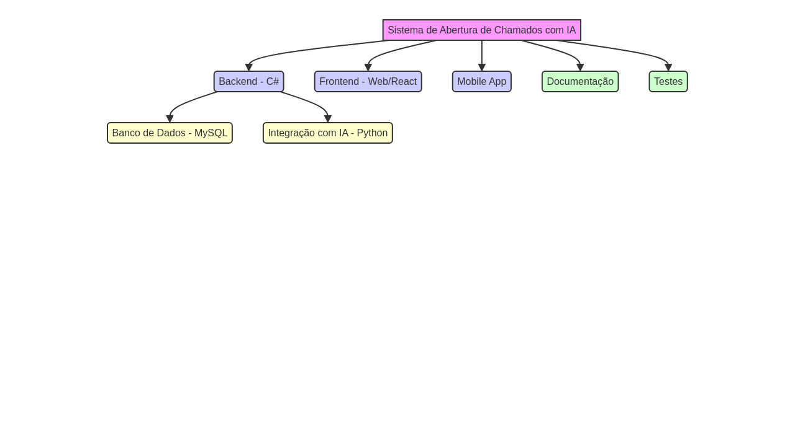

# 🏗️ Estrutura do Projeto

## 🗺️ Visão Geral da Arquitetura

Este repositório detalha a **estrutura de diretórios, arquitetura e os requisitos** do **Sistema de Abertura de Chamados com IA**.

## 🧩 Diagrama de Componentes

O diagrama a seguir ilustra a arquitetura de alto nível do sistema e a interação entre seus principais componentes.

<p align="center">
  
</p>

## 📁 Estrutura de Diretórios

A organização do código-fonte segue a seguinte estrutura:

```
/chamados-app  
│  
├── /backend/       # Servidor, APIs e integração com banco de dados  
├── /frontend/      # Aplicação web  
├── /mobile/        # Aplicação mobile  
├── /docs/          # Documentação detalhada  
├── /tests/         # Testes automatizados  
└── README.md       # Documentação principal
```

---

## ✅ Requisitos Funcionais

| ID | Requisito | Descrição |
| :---: | :--- | :--- |
| **RF1** | Gestão de Chamados | Registrar, acompanhar status, listar, atualizar status e registrar soluções. |
| **RF2** | Inteligência Artificial | Analisar, classificar, sugerir soluções, avaliar prioridade, encaminhar chamados e aprender com soluções. |
| **RF3** | Gerenciamento de Usuários | Cadastrar colaboradores, definir hierarquia e notificar sobre novos chamados. |
| **RF4** | Gerar Relatórios | Mostrar chamados dos últimos 5, 7 e 15 dias, quantidade de chamados resolvidos e pendentes. |
| **RF5** | Gerenciar Notificações | Exibir número de notificações e notificar funcionários sobre novos chamados. |

## 🔒 Requisitos Não Funcionais

| ID | Requisito | Descrição |
| :---: | :--- | :--- |
| **RNF1** | Desempenho | Resposta rápida mesmo com múltiplos chamados. |
| **RNF2** | Usabilidade | Interface intuitiva e acessível (desktop e mobile). |
| **RNF3** | Conformidade com LGPD | Garantia de privacidade dos dados pessoais. |
| **RNF4** | Disponibilidade | Sistema disponível em horário comercial, com aviso prévio para manutenção. |
| **RNF5** | Segurança | Criptografia de dados e autenticação forte. |

---

## ▶️ Executar o Projeto

Siga as instruções abaixo para iniciar o backend e o frontend:

#### Backend (C#)
```bash
dotnet run --project ./src/Backend
```

#### Frontend (Node.js / React / Outro)
```bash
npm start
```

---

## 🔗 Voltar ao Projeto Principal

[⬅️ Repositório Principal](https://github.com/Nicolasdev29/Proj-Sist-Orientado-A-Objetos-Atividade-boas-praticas-github)

*Este README foi aprimorado para melhor visualização e organização.*
